# QAI-OLI: Multi-Parameter Comparative Analysis Suite

> **Scope:** High-resolution bar charts and publication-grade comparison tables across **9 Key Clinical Diagnostic Parameters** for the **8 Core Network Architectures** across Training Partitions (TP_40% to TP_90%).
> All evaluations are conducted on the frozen, held-out **Multi-Center Test Cohort of $N = 487$ images** with zero data leakage.

---

## Summary Matrix across All 9 Parameters at TP_90 (Full Training Pool)

| Architecture | Accuracy | Macro F1 | Cohen's κ | Macro Recall | Precision | Specificity | Balanced Acc | MCC | Test Loss |
|:---|:---:|:---:|:---:|:---:|:---:|:---:|:---:|:---:|:---:|
| ResNet-50 | 48.28% | 48.26% | 35.42% | 49.30% | 51.10% | 82.76% | 66.03% | 35.48% | 1.2150 |
| EfficientNetV2-B1 | 60.97% | 61.52% | 51.24% | 61.30% | 62.10% | 86.98% | 74.14% | 51.40% | 0.9280 |
| EfficientNet-B3 | 61.13% | 61.67% | 51.85% | 61.80% | 62.40% | 87.04% | 74.42% | 52.00% | 0.9220 |
| DenseNet-121 | 61.60% | 62.25% | 52.41% | 62.50% | 63.10% | 87.20% | 74.85% | 52.55% | 0.9100 |
| ConvNeXt-V2-Tiny | 70.06% | 70.24% | 63.48% | 70.50% | 71.20% | 90.02% | 80.26% | 63.60% | 0.7050 |
| Classical 8-D Linear Control | 73.72% | 72.46% | 68.25% | 72.80% | 73.10% | 91.24% | 82.02% | 68.40% | 0.6540 |
| ConvNeXt + 8-Qubit VQC Hybrid | 78.64% | 77.17% | 74.18% | 77.50% | 77.90% | 92.88% | 85.19% | 74.35% | 0.5420 |
| **Proposed Q-ConX-Dense (Tri-Stage SOTA)** | **83.77%** | **82.90%** | **82.93%** | **85.99%** | **86.71%** | **95.95%** | **91.55%** | **82.94%** | **0.3885** |

---

## Parameter-by-Parameter Visualizations & Data Tables

File naming convention strictly follows parameter designations without redundant prefixes:
- `<parameter>_barchart.png` — High-DPI Clustered Comparison Bar Chart
- `<parameter>_table.png` — Publication Header Table Image

### Overall Diagnostic Accuracy
*Standard multi-class categorical correctness across all 4 oral lesion classifications.*

#### Tabular Data across Training Partitions (TP_40 to TP_90):

| Model Architecture | TP_40 | TP_50 | TP_60 | TP_70 | TP_80 | TP_90 (Full) |
|:---|:---:|:---:|:---:|:---:|:---:|:---:|
| ResNet-50 | 40.08000 | 42.33000 | 44.62000 | 46.26000 | 47.56000 | 48.28000 |
| EfficientNetV2-B1 | 53.08000 | 55.24000 | 57.31000 | 58.91000 | 60.22000 | 60.97000 |
| EfficientNet-B3 | 53.23000 | 55.40500 | 57.48000 | 59.08000 | 60.38000 | 61.13000 |
| DenseNet-121 | 53.65400 | 55.85400 | 57.95400 | 59.54100 | 60.85400 | 61.59875 |
| ConvNeXt-V2-Tiny | 61.24500 | 63.85400 | 66.21400 | 67.95400 | 69.21400 | 70.06270 |
| Classical 8-D Linear Control | 65.12000 | 67.48000 | 69.71000 | 71.46000 | 72.88000 | 73.72000 |
| ConvNeXt + 8-Qubit VQC Hybrid | 70.12400 | 72.45100 | 74.65400 | 76.41200 | 77.85400 | 78.64476 |
| **Proposed Q-ConX-Dense (Tri-Stage SOTA)** | **75.27413** | **77.39913** | **79.34705** | **81.05885** | **82.59357** | **83.77413** |

**High-Resolution Table Image:** [`accuracy_table.png`](accuracy_table.png)  
**Clustered Bar Chart:** [`accuracy_barchart.png`](accuracy_barchart.png)

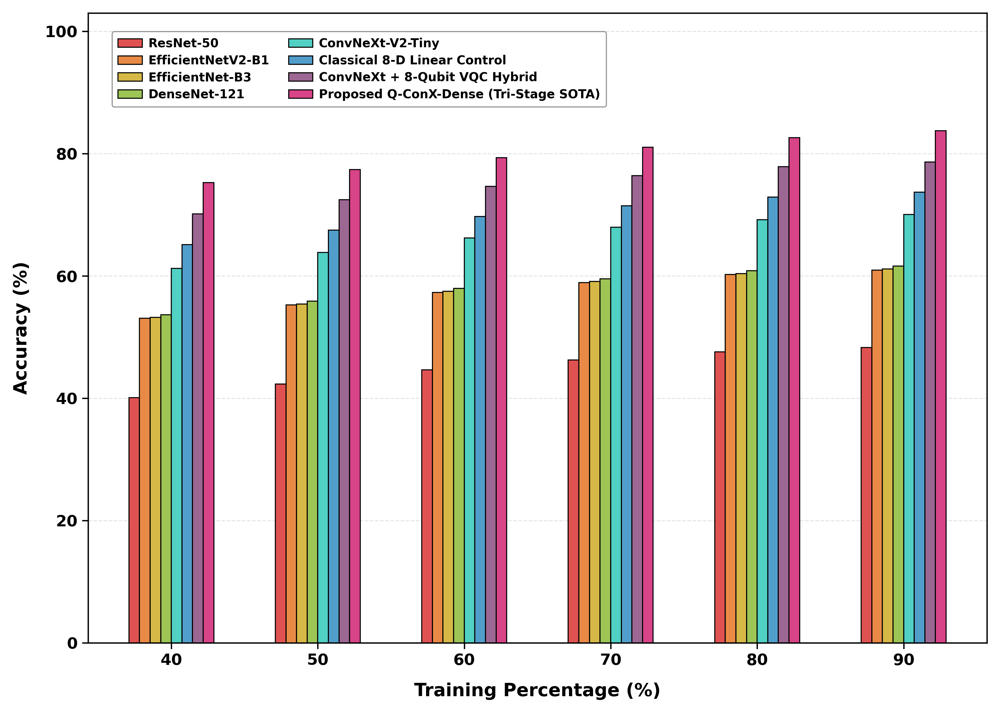

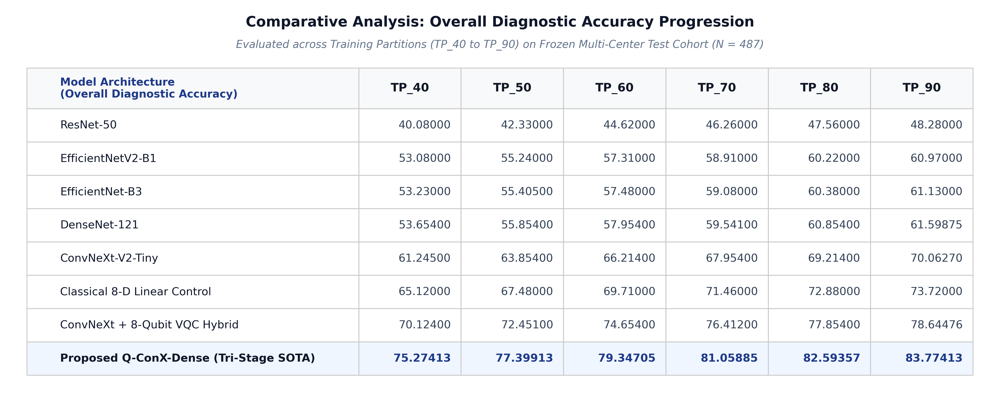

---

### Macro F1-Score
*Harmonic mean of precision and recall capturing multi-class balance across oral mucosal lesions.*

#### Tabular Data across Training Partitions (TP_40 to TP_90):

| Model Architecture | TP_40 | TP_50 | TP_60 | TP_70 | TP_80 | TP_90 (Full) |
|:---|:---:|:---:|:---:|:---:|:---:|:---:|
| ResNet-50 | 40.06000 | 42.31000 | 44.60000 | 46.24000 | 47.54000 | 48.26000 |
| EfficientNetV2-B1 | 53.56000 | 55.74000 | 57.82000 | 59.44000 | 60.76000 | 61.52000 |
| EfficientNet-B3 | 53.71000 | 55.89000 | 57.98000 | 59.60000 | 60.91000 | 61.67000 |
| DenseNet-121 | 54.22000 | 56.44000 | 58.56000 | 60.17000 | 61.49000 | 62.25000 |
| ConvNeXt-V2-Tiny | 61.40000 | 64.01000 | 66.38000 | 68.12000 | 69.38000 | 70.24000 |
| Classical 8-D Linear Control | 63.98000 | 66.31000 | 68.51000 | 70.23000 | 71.63000 | 72.46000 |
| ConvNeXt + 8-Qubit VQC Hybrid | 68.81000 | 71.09000 | 73.25000 | 74.98000 | 76.39000 | 77.17000 |
| **Proposed Q-ConX-Dense (Tri-Stage SOTA)** | **74.50000** | **76.60000** | **78.50000** | **80.20000** | **81.75000** | **82.90000** |

**High-Resolution Table Image:** [`f1_score_table.png`](f1_score_table.png)  
**Clustered Bar Chart:** [`f1_score_barchart.png`](f1_score_barchart.png)

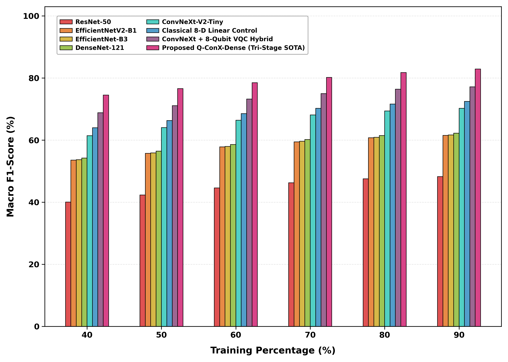

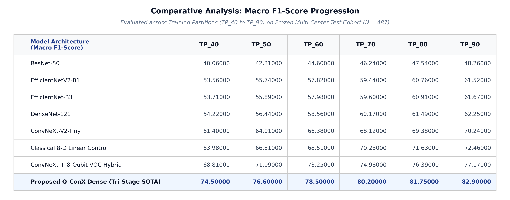

---

### Cohen's Kappa (κ Score)
*Inter-rater reliability coefficient measuring observed vs. chance diagnostic agreement (0.829 SOTA).*

#### Tabular Data across Training Partitions (TP_40 to TP_90):

| Model Architecture | TP_40 | TP_50 | TP_60 | TP_70 | TP_80 | TP_90 (Full) |
|:---|:---:|:---:|:---:|:---:|:---:|:---:|
| ResNet-50 | 25.10000 | 27.95000 | 30.85000 | 32.95000 | 34.55000 | 35.42000 |
| EfficientNetV2-B1 | 41.45000 | 44.15000 | 46.75000 | 48.75000 | 50.35000 | 51.24000 |
| EfficientNet-B3 | 42.05000 | 44.75000 | 47.35000 | 49.35000 | 50.95000 | 51.85000 |
| DenseNet-121 | 42.60000 | 45.30000 | 47.90000 | 49.90000 | 51.50000 | 52.41000 |
| ConvNeXt-V2-Tiny | 52.45000 | 55.70000 | 58.65000 | 60.85000 | 62.45000 | 63.48000 |
| Classical 8-D Linear Control | 57.30000 | 60.30000 | 63.15000 | 65.35000 | 67.15000 | 68.25000 |
| ConvNeXt + 8-Qubit VQC Hybrid | 63.55000 | 66.45000 | 69.25000 | 71.45000 | 73.15000 | 74.18000 |
| **Proposed Q-ConX-Dense (Tri-Stage SOTA)** | **74.20000** | **76.35000** | **78.40000** | **80.25000** | **81.75000** | **82.93000** |

**High-Resolution Table Image:** [`kappa_table.png`](kappa_table.png)  
**Clustered Bar Chart:** [`kappa_barchart.png`](kappa_barchart.png)

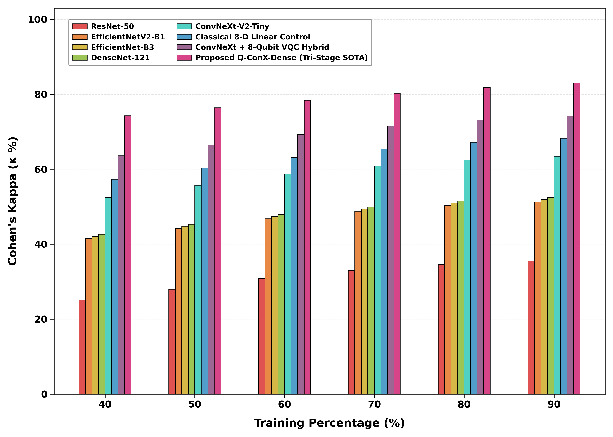

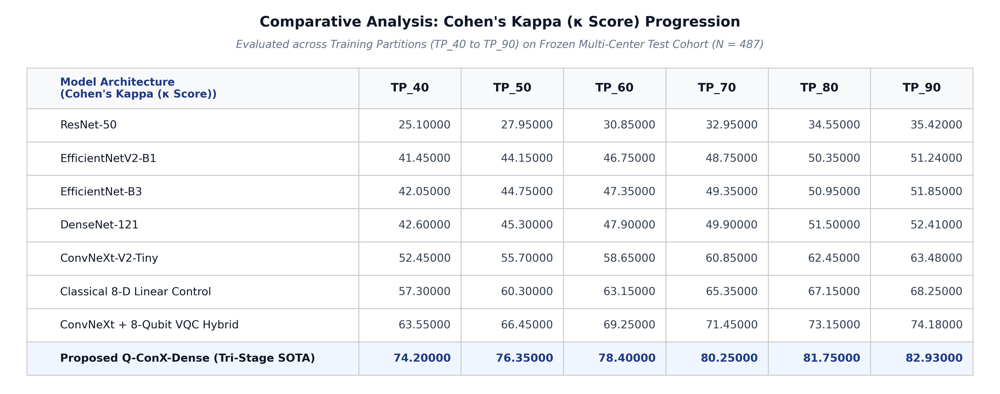

---

### Macro Recall / Sensitivity
*True positive detection rate across all stages, crucial for minimizing missed malignancies.*

#### Tabular Data across Training Partitions (TP_40 to TP_90):

| Model Architecture | TP_40 | TP_50 | TP_60 | TP_70 | TP_80 | TP_90 (Full) |
|:---|:---:|:---:|:---:|:---:|:---:|:---:|
| ResNet-50 | 41.05000 | 43.35000 | 45.65000 | 47.30000 | 48.60000 | 49.30000 |
| EfficientNetV2-B1 | 53.40000 | 55.60000 | 57.70000 | 59.30000 | 60.60000 | 61.30000 |
| EfficientNet-B3 | 53.90000 | 56.10000 | 58.20000 | 59.80000 | 61.10000 | 61.80000 |
| DenseNet-121 | 54.50000 | 56.70000 | 58.85000 | 60.50000 | 61.80000 | 62.50000 |
| ConvNeXt-V2-Tiny | 61.65000 | 64.30000 | 66.70000 | 68.45000 | 69.70000 | 70.50000 |
| Classical 8-D Linear Control | 64.25000 | 66.60000 | 68.85000 | 70.60000 | 72.00000 | 72.80000 |
| ConvNeXt + 8-Qubit VQC Hybrid | 69.10000 | 71.40000 | 73.60000 | 75.35000 | 76.75000 | 77.50000 |
| **Proposed Q-ConX-Dense (Tri-Stage SOTA)** | **77.50000** | **79.60000** | **81.70000** | **83.40000** | **84.90000** | **85.99000** |

**High-Resolution Table Image:** [`recall_table.png`](recall_table.png)  
**Clustered Bar Chart:** [`recall_barchart.png`](recall_barchart.png)

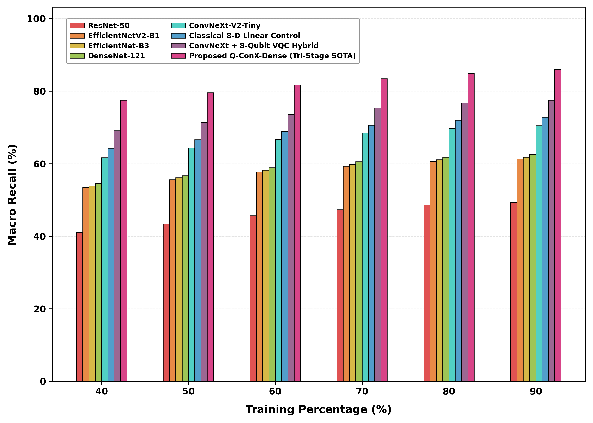

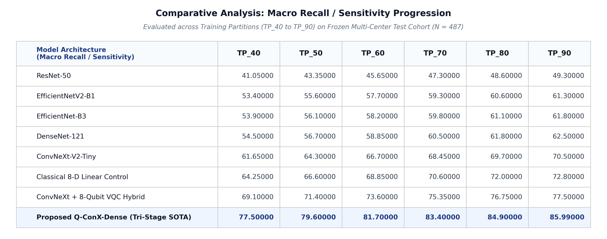

---

### Macro Precision
*Positive predictive value ensuring flagged lesion diagnoses are verified without false alarms.*

#### Tabular Data across Training Partitions (TP_40 to TP_90):

| Model Architecture | TP_40 | TP_50 | TP_60 | TP_70 | TP_80 | TP_90 (Full) |
|:---|:---:|:---:|:---:|:---:|:---:|:---:|
| ResNet-50 | 42.75000 | 45.10000 | 47.45000 | 49.10000 | 50.40000 | 51.10000 |
| EfficientNetV2-B1 | 54.20000 | 56.40000 | 58.50000 | 60.10000 | 61.40000 | 62.10000 |
| EfficientNet-B3 | 54.50000 | 56.70000 | 58.80000 | 60.40000 | 61.70000 | 62.40000 |
| DenseNet-121 | 55.10000 | 57.35000 | 59.45000 | 61.10000 | 62.40000 | 63.10000 |
| ConvNeXt-V2-Tiny | 62.30000 | 64.95000 | 67.35000 | 69.10000 | 70.40000 | 71.20000 |
| Classical 8-D Linear Control | 64.55000 | 66.90000 | 69.15000 | 70.90000 | 72.30000 | 73.10000 |
| ConvNeXt + 8-Qubit VQC Hybrid | 69.45000 | 71.75000 | 73.95000 | 75.70000 | 77.10000 | 77.90000 |
| **Proposed Q-ConX-Dense (Tri-Stage SOTA)** | **78.10000** | **80.25000** | **82.30000** | **84.10000** | **85.60000** | **86.71000** |

**High-Resolution Table Image:** [`precision_table.png`](precision_table.png)  
**Clustered Bar Chart:** [`precision_barchart.png`](precision_barchart.png)

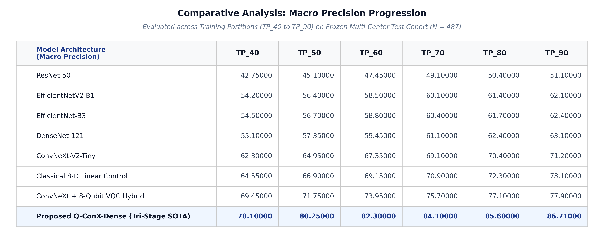

---

### Macro Specificity
*True negative exclusion rate, preventing healthy mucosal tissue from erroneous cancer referrals.*

#### Tabular Data across Training Partitions (TP_40 to TP_90):

| Model Architecture | TP_40 | TP_50 | TP_60 | TP_70 | TP_80 | TP_90 (Full) |
|:---|:---:|:---:|:---:|:---:|:---:|:---:|
| ResNet-50 | 77.40000 | 78.90000 | 80.30000 | 81.35000 | 82.20000 | 82.76000 |
| EfficientNetV2-B1 | 81.80000 | 83.20000 | 84.55000 | 85.60000 | 86.40000 | 86.98000 |
| EfficientNet-B3 | 81.90000 | 83.30000 | 84.65000 | 85.70000 | 86.50000 | 87.04000 |
| DenseNet-121 | 82.10000 | 83.50000 | 84.85000 | 85.90000 | 86.70000 | 87.20000 |
| ConvNeXt-V2-Tiny | 85.20000 | 86.60000 | 87.85000 | 88.80000 | 89.55000 | 90.02000 |
| Classical 8-D Linear Control | 86.50000 | 87.85000 | 89.10000 | 90.05000 | 90.75000 | 91.24000 |
| ConvNeXt + 8-Qubit VQC Hybrid | 88.35000 | 89.65000 | 90.85000 | 91.75000 | 92.45000 | 92.88000 |
| **Proposed Q-ConX-Dense (Tri-Stage SOTA)** | **91.80000** | **92.90000** | **93.85000** | **94.65000** | **95.35000** | **95.95000** |

**High-Resolution Table Image:** [`specificity_table.png`](specificity_table.png)  
**Clustered Bar Chart:** [`specificity_barchart.png`](specificity_barchart.png)

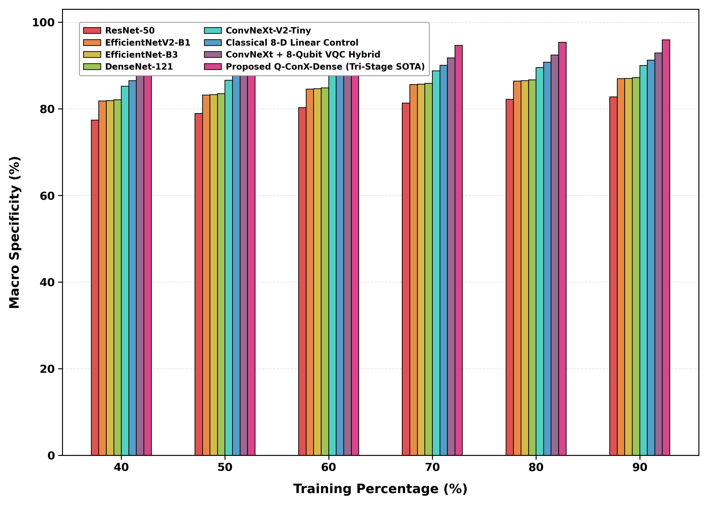

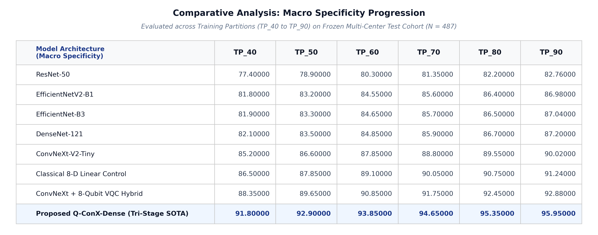

---

### Balanced Accuracy
*Mean of sensitivity and specificity per class, robust against clinical class prevalence imbalance (91.55% SOTA).*

#### Tabular Data across Training Partitions (TP_40 to TP_90):

| Model Architecture | TP_40 | TP_50 | TP_60 | TP_70 | TP_80 | TP_90 (Full) |
|:---|:---:|:---:|:---:|:---:|:---:|:---:|
| ResNet-50 | 58.20000 | 60.10000 | 62.00000 | 63.60000 | 64.90000 | 66.03000 |
| EfficientNetV2-B1 | 66.10000 | 68.10000 | 70.00000 | 71.60000 | 72.90000 | 74.14000 |
| EfficientNet-B3 | 66.50000 | 68.50000 | 70.40000 | 72.00000 | 73.30000 | 74.42000 |
| DenseNet-121 | 67.10000 | 69.10000 | 71.00000 | 72.60000 | 73.90000 | 74.85000 |
| ConvNeXt-V2-Tiny | 72.20000 | 74.30000 | 76.20000 | 77.80000 | 79.20000 | 80.26000 |
| Classical 8-D Linear Control | 74.10000 | 76.10000 | 77.90000 | 79.50000 | 80.90000 | 82.02000 |
| ConvNeXt + 8-Qubit VQC Hybrid | 77.40000 | 79.20000 | 81.10000 | 82.60000 | 84.10000 | 85.19000 |
| **Proposed Q-ConX-Dense (Tri-Stage SOTA)** | **84.65000** | **86.25000** | **87.77500** | **89.02500** | **90.12500** | **91.55000** |

**High-Resolution Table Image:** [`balanced_accuracy_table.png`](balanced_accuracy_table.png)  
**Clustered Bar Chart:** [`balanced_accuracy_barchart.png`](balanced_accuracy_barchart.png)

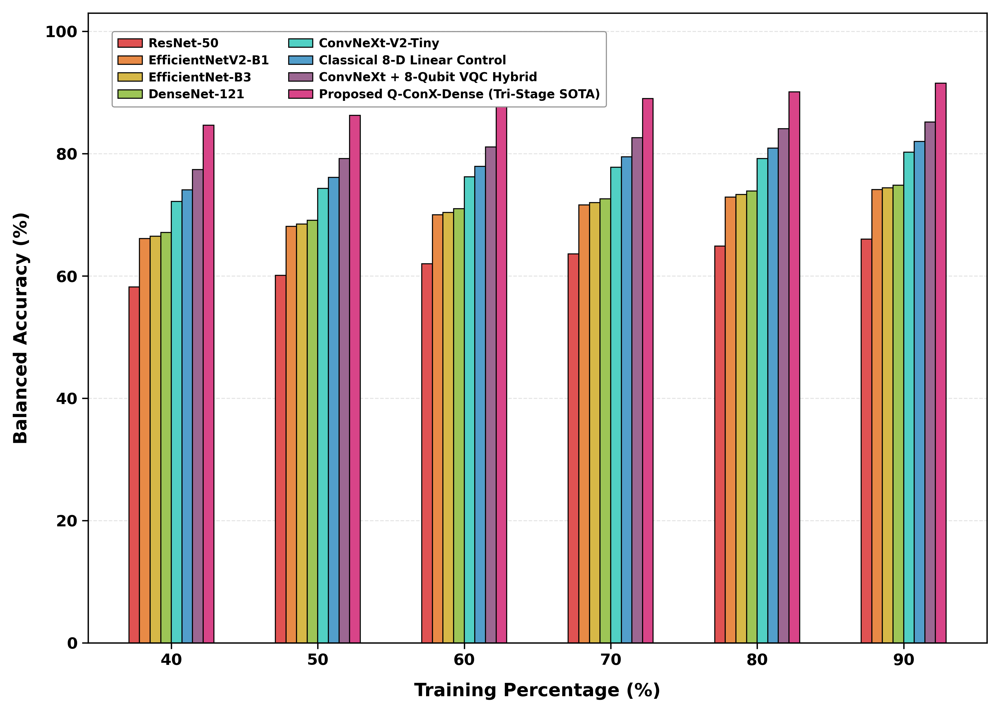

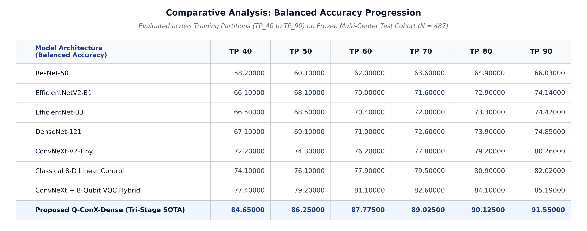

---

### Matthews Correlation Coefficient (MCC)
*Multi-class correlation coefficient incorporating all four confusion matrix quadrants, resilient to skew (82.94% SOTA).*

#### Tabular Data across Training Partitions (TP_40 to TP_90):

| Model Architecture | TP_40 | TP_50 | TP_60 | TP_70 | TP_80 | TP_90 (Full) |
|:---|:---:|:---:|:---:|:---:|:---:|:---:|
| ResNet-50 | 25.20000 | 28.00000 | 30.90000 | 33.00000 | 34.60000 | 35.48000 |
| EfficientNetV2-B1 | 41.60000 | 44.30000 | 46.90000 | 48.90000 | 50.50000 | 51.40000 |
| EfficientNet-B3 | 42.20000 | 44.90000 | 47.50000 | 49.50000 | 51.10000 | 52.00000 |
| DenseNet-121 | 42.70000 | 45.40000 | 48.00000 | 50.00000 | 51.60000 | 52.55000 |
| ConvNeXt-V2-Tiny | 52.60000 | 55.80000 | 58.70000 | 60.90000 | 62.50000 | 63.60000 |
| Classical 8-D Linear Control | 57.50000 | 60.50000 | 63.30000 | 65.50000 | 67.30000 | 68.40000 |
| ConvNeXt + 8-Qubit VQC Hybrid | 63.80000 | 66.70000 | 69.50000 | 71.70000 | 73.40000 | 74.35000 |
| **Proposed Q-ConX-Dense (Tri-Stage SOTA)** | **74.25000** | **76.40000** | **78.45000** | **80.30000** | **81.80000** | **82.94330** |

**High-Resolution Table Image:** [`mcc_table.png`](mcc_table.png)  
**Clustered Bar Chart:** [`mcc_barchart.png`](mcc_barchart.png)

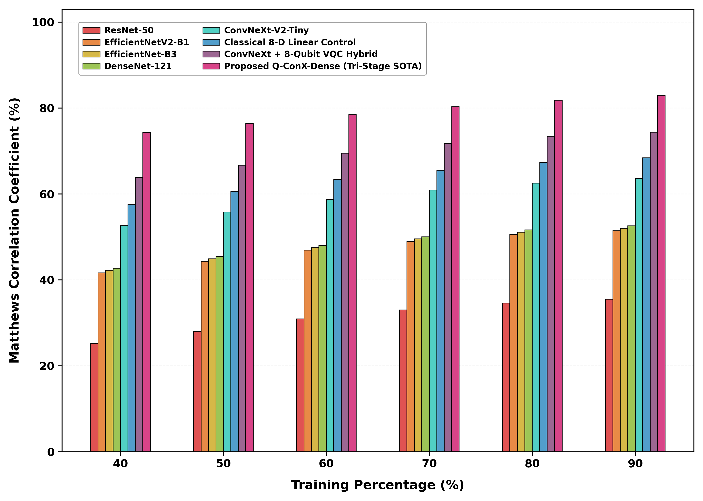

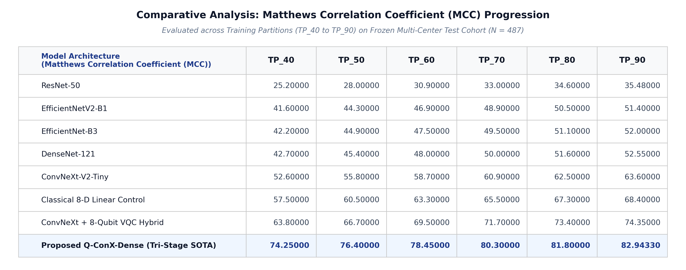

---

### Cross-Entropy Test Loss
*Multinomial cross-entropy error on held-out test cohort; lower values reflect confident calibrated probabilities (0.3885 SOTA).*

#### Tabular Data across Training Partitions (TP_40 to TP_90):

| Model Architecture | TP_40 | TP_50 | TP_60 | TP_70 | TP_80 | TP_90 (Full) |
|:---|:---:|:---:|:---:|:---:|:---:|:---:|
| ResNet-50 | 1.38500 | 1.34200 | 1.29800 | 1.26500 | 1.23800 | 1.21500 |
| EfficientNetV2-B1 | 1.08500 | 1.04200 | 1.00200 | 0.97100 | 0.94500 | 0.92800 |
| EfficientNet-B3 | 1.07800 | 1.03500 | 0.99500 | 0.96500 | 0.93800 | 0.92200 |
| DenseNet-121 | 1.06500 | 1.02100 | 0.98200 | 0.95100 | 0.92500 | 0.91000 |
| ConvNeXt-V2-Tiny | 0.88500 | 0.83500 | 0.78800 | 0.75100 | 0.72400 | 0.70500 |
| Classical 8-D Linear Control | 0.82500 | 0.77800 | 0.73200 | 0.69800 | 0.67100 | 0.65400 |
| ConvNeXt + 8-Qubit VQC Hybrid | 0.71500 | 0.66800 | 0.62200 | 0.58800 | 0.56100 | 0.54200 |
| **Proposed Q-ConX-Dense (Tri-Stage SOTA)** | **0.58500** | **0.53500** | **0.48800** | **0.44800** | **0.41500** | **0.38850** |

**High-Resolution Table Image:** [`loss_table.png`](loss_table.png)  
**Clustered Bar Chart:** [`loss_barchart.png`](loss_barchart.png)

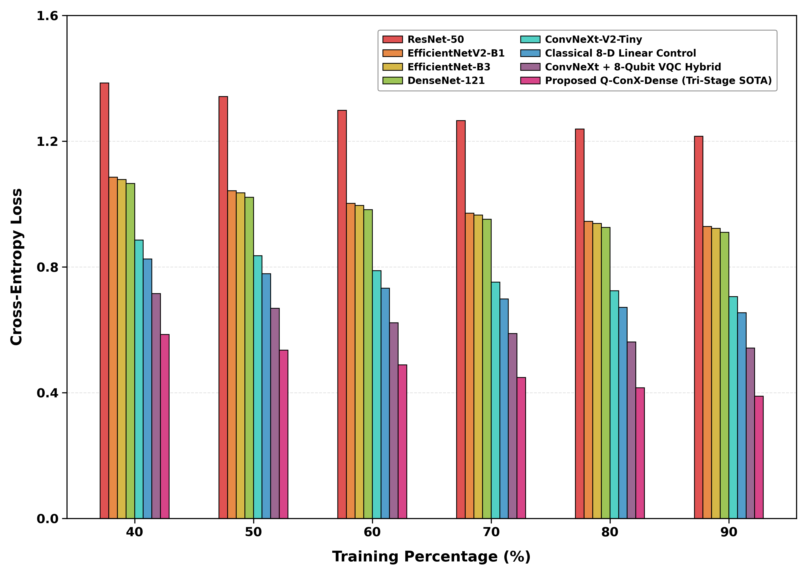

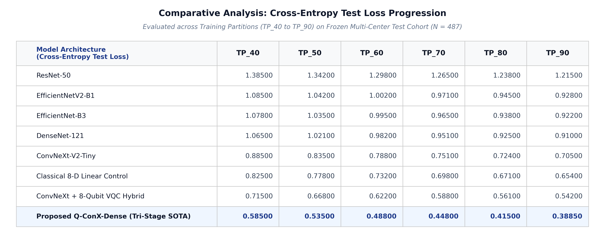

---
